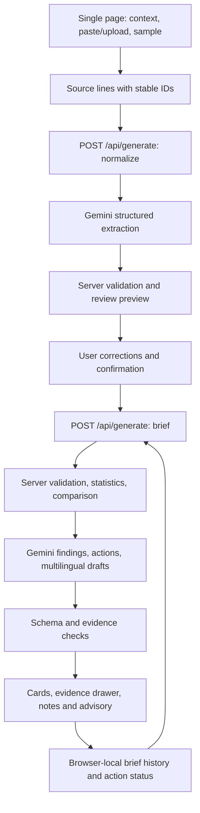

# WardAir — civic air-quality action desk

Status: implementation in progress, authorized by the user. Core single-page workflow and server endpoint are implemented. Lint, TypeScript, automated tests and production-build checks are being finalized. No GitHub push or Vercel deployment has been performed.

## Implementation update — 14 November 2026

Implemented: local/AI intake, editable row review, deterministic PM unit conversion, exclusions and duplicates, source-linked observation metrics, paired sample periods, role-specific actions, status/notes, bilingual document views, copy/download/print styles, bounded local history and validated export/import, request limits and safe API errors. `npm test` covers analysis and mocked endpoint failures. See README for supported input and explicit limits.

Release checks remaining: live two-operation Gemini smoke test, browser/keyboard/narrow-screen/print review (browser preview host unavailable in this session), fluent sample-translation review, Vercel environment/plan and distributed abuse-protection configuration, then deployment and live smoke test. Model availability must be tested with generation, not only model listing.

Verified compatibility change: removed the starter Tailwind Turbopack CSS loader after repeated CSS-worker port-binding failures. This implementation uses native global CSS; Cache Components and partial prefetching are preserved.

The original checklist below remains the design/acceptance reference; unchecked items are not claims that implementation is absent.

## Purpose and concrete societal use

Help a ward team decide where to inspect, a housing society decide what it can change on its premises, and a school decide how to reduce pupils' exposure. Turn locally supplied air readings into an evidence-backed action brief, rather than a generic chatbot or citywide AQI dashboard.

Demo scenario: a fictional ward has readings near a school gate, a residential lane, and a market junction. A second reporting period contains a changing local hotspot and a sensor outage. Mixed units, missing values, duplicates, and ambiguous timestamps force the workflow to explain what it can and cannot conclude. School-gate exposure can justify a pickup-management recommendation; readings alone cannot prove vehicle exhaust caused it.

## Repository baseline

- Next.js 16.4.6 App Router, React 19.3.0, TypeScript strict mode, Tailwind CSS 4.3.3.
- Already installed: `@google/genai` ^3.3.0 and `lucide-react` ^1.72.0.
- `src/app/page.tsx` is the starter page; there is no generation endpoint yet.
- `src/app/layout.tsx` contains starter metadata and Geist fonts; `globals.css` contains starter styles.
- `next.config.ts` enables `cacheComponents`, `partialPrefetching`, and the Tailwind Turbopack rule. Preserve these unless a verified compatibility issue requires a change.
- Scripts available: `npm run dev`, `npm run build`, `npm run lint`.
- `.env.local` exists; its contents were not inspected. `.env*` is ignored by Git.
- Follow `AGENTS.md`: one responsive page, no auth/complex database, prominent **Load Sample Data**, skeletons during generation, readable cards, all Gemini calls through `/api/generate`.
- Before implementation, consult the relevant installed Next.js docs again. Route handlers and `maxDuration` guidance have been reviewed for this plan.

## Connected single-page workflow

1. **Set local context:** ward/locality, reporting timezone, requester (ward officer / housing society / school), language, and citizen reading level (simple / standard). Default language options: English, Hindi, Marathi; locality is editable, not inferred from a user profile.
2. **Bring data:** paste spreadsheet text or upload CSV/TSV/TXT. Keep filename, original lines, and stable source identifiers. Start with these formats; XLSX, PDF, images, OCR, and live feeds are later extensions.
3. **Review interpretation:** Gemini proposes header mappings, site aliases, dates, units, and normalized observations. Show the source alongside an editable preview, conversion notes, exclusions, and unresolved fields. Ask the user to resolve ambiguity before treating an observation as usable.
4. **Generate a local brief:** deterministic analysis computes statistics; Gemini explains that evidence and proposes actions for the chosen requester. Show coverage and uncertainty alongside results.
5. **Inspect and act:** open evidence links from each finding, review ranked actions with owner and verification step, and record local action status.
6. **See what changed:** compare with the previous successful brief in the same locality. Explain comparable changes and changes caused by coverage or sensor differences separately.
7. **Communicate:** provide an internal operational note and a citizen advisory in English plus the selected additional language, at the chosen citizen reading level. Copy, download text, and print within this page; publication remains a human action.

The prominent **Load Sample Data** button loads both periods and a clearly labeled precomputed sample brief, immediately demonstrating the whole workflow without quota or a key. A separate **Analyze with Gemini** action processes the sample through the real pipeline. Never present stored sample output as a live model response.

## Architecture for this repo and Vercel

### Planned file responsibilities

| File | Responsibility |
| --- | --- |
| `src/app/page.tsx` | All page sections, client state, inputs, loading/error states, evidence view, history, copy/download/print |
| `src/app/globals.css` | Responsive styling, accessible states, skeletons, multilingual text and print layout |
| `src/app/layout.tsx` | Product metadata and document/font defaults |
| `src/app/api/generate/route.ts` | Only Gemini-facing HTTP endpoint; POST operation dispatch, limits, errors, orchestration |
| `src/lib/air/types.ts` | Shared source, observation, metric, evidence, brief, and history types |
| `src/lib/air/validation.ts` | Runtime request/model-output checks and evidence-reference validation |
| `src/lib/air/normalize.ts` | Source indexing, explicit unit conversions, date checks, quality flags |
| `src/lib/air/analyze.ts` | Reproducible statistics, coverage, relative hotspots, comparable deltas |
| `src/lib/air/prompts.ts` | Server-only extraction and briefing instructions, bounded JSON schemas |
| `src/lib/air/sample.ts` | Fictional two-period messy dataset and labeled sample outputs |
| `src/lib/air/history.ts` | Versioned browser persistence, bounded history, import/export validation |

Keep the interactive page in `page.tsx`; helper modules do not introduce more pages. Add only small dependencies that prove necessary. Prefer native file reading and existing tools; consider one schema validator if it simplifies reliable validation.

### API contract and Gemini usage

- `POST /api/generate` with a discriminated operation: `normalize` or `brief`.
- `normalize` accepts bounded source text plus context; returns candidate observations, source references, mapping assumptions, quality issues, and unresolved questions.
- `brief` accepts the reviewed dataset, context, and optional bounded previous snapshot; server revalidates and recomputes metrics before passing evidence to Gemini.
- Use the installed SDK on the server: `new GoogleGenAI({ apiKey: process.env.GEMINI_API_KEY })`, then `ai.models.generateContent(...)` and `response.text`.
- Configure `responseMimeType: "application/json"` and a supported `responseJsonSchema`, then validate at runtime. Structured output constrains shape, not factual accuracy.
- Set a server-only `GEMINI_MODEL` to a model actually available on the supplied free-tier project and supporting structured output. Verify it in AI Studio before choosing a default; do not assume the SDK README example or a paid model is available to this key.
- Two intentional model calls per new dataset: extraction, then briefing. Generate both document types and requested languages in the briefing call. No model call on typing, tab changes, evidence expansion, or switching between already generated translations.
- Changing persona/language after generation explicitly regenerates the brief using reviewed data, without repeating extraction. Mark old output stale whenever context or input changes.
- Keep numerical facts in server-owned metric objects. Gemini references metric IDs; UI renders numeric values from those objects. Validate model claims against allowed evidence and reject unknown references or contradictory output.
- Treat table contents as untrusted data, including any instructions embedded in cells. Do not grant model tools, arbitrary fetching, or code execution.
- Errors use stable codes and readable messages: invalid input, oversized input, unresolved data, missing key, unavailable model, quota, timeout, invalid output, and upstream failure. Preserve the reviewed data and previous successful brief on failure.

### Evidence and data model

- **Source:** ID, filename/paste label, original text, line/cell coordinates, content fingerprint.
- **Observation:** ID, source references, original fields, site, pollutant, original value/unit, normalized value/unit, timestamp/timezone, averaging period, quality flags, inclusion decision and reason. Missing values remain null.
- **Metric:** ID, calculation/version, value/unit, site/pollutant/time window, included/excluded observation IDs, sample count, and coverage limitations.
- **Finding:** text, metric/observation references, evidence strength with reasons, limitation, and optional explicitly labeled hypothesis.
- **Action:** priority with rationale, requesting role, responsible owner, location, time horizon, feasibility, evidence references, verification step, status. General precautionary advice links to the configured guidance source rather than pretending it came from a reading.
- **Brief snapshot:** ID, schema/prompt/model versions, locality/context, reporting window, reviewed observations, metrics, findings, actions, bilingual documents, generated time, and baseline snapshot ID.
- Traceability chain: citizen sentence or internal finding → evidence ID → metric calculation → included observations → original source cells. Derived findings also expose exclusions and transformations.
- Every evidence drawer must explain the calculation and show original versus converted values. No fabricated provenance, silent repairs, or unsupported confidence percentages.

### Analysis rules and boundaries

- Normalize explicit PM mass-concentration units (for example mg/m³ to µg/m³) deterministically. Unknown units stay unresolved. Do not convert gas ppm/ppb to mass concentration without the required pollutant and environmental assumptions.
- Handle repeated headers, mixed delimiters, blanks, `NA`, decimal formats, duplicate rows, negative values, implausible readings, sensor flags, and ambiguous day/month dates visibly. Suspicious outliers are flagged, not silently deleted.
- Distinguish missing samples from zero pollution. Report expected coverage only when sampling cadence/window is supplied or confirmed; otherwise report counts and “expected coverage unknown.”
- Keep pollutants, averaging periods, timezones, and incompatible AQI scales separate. Use simple observation summaries labeled as such; never label sparse spot-reading means as regulatory daily averages.
- Rank observed locations within comparable data, showing sample counts and coverage. Say “highest among supplied locations”; do not imply a wardwide spatial estimate or fabricate map coordinates.
- No official AQI or regulatory health bands in the initial release unless a separately verified jurisdictional standard and its required averaging/coverage rules are implemented. Supplied AQI must retain its named scale; unspecified AQI cannot support scale-based advice.
- Separate observed patterns, possible explanations, and verification needs. Sensor failure, incomplete periods, or unequal location sampling may prevent a trend conclusion.
- Comparison matches locality, site aliases, pollutant, units, averaging period, and comparable windows. Show absolute delta; percentage only with a meaningful nonzero baseline. Flag added/lost sites and changed coverage; return “not comparable” when appropriate.
- A completed intervention and improved readings can be displayed together, but cannot establish causation from two briefs.
- With no usable data, produce a data-repair checklist and proportionate general guidance rather than invented hotspots.

### Role-specific action design

| Requester | Examples within their remit | Escalation |
| --- | --- | --- |
| Ward officer | Targeted site inspection, dust-control follow-up, waste-burning checks, monitoring placement | Refer specialist enforcement/transport issues to the relevant department |
| Housing society | Review onsite dust and waste practices, discourage idling, communicate exposure precautions | Refer offsite sources or persistent issues to the ward team |
| School | Adjust outdoor activity using verified guidance, reduce gate congestion, communicate with caregivers | Coordinate surrounding-road issues with local authorities |

Rank actions by evidence strength, potential exposure reduction, affected sensitive groups, urgency, and requester control. Show the reasons, not an invented optimization score. Include “what to verify next” when evidence is weak.

Internal notes include situation, evidence, uncertainty, changes, owners, and next review. Citizen advisories use short sentences, local times/places, practical steps, and separate guidance for children, older adults, and people sensitive to poor air. Preserve numbers, caveats, dates, and evidence IDs across languages. Use reviewed public-health guidance with source/version metadata; avoid diagnosis or blanket school-closure instructions. Have a fluent reviewer check sample translations before the demo.

### Persistence and Vercel constraints

- No database or auth. Store a bounded number of successful briefs and action states in versioned localStorage; handle quota, corruption, and SSR/hydration safely. Provide clear history and validated export/import for moving between devices.
- History is browser-local, not shared across teams. Compare against the last compatible successful snapshot or an explicitly selected baseline; failed runs never replace it. Keep raw text only in the current session by default; saved evidence includes the source excerpts required for traceability.
- Vercel serves Next.js and the Node.js route handler. Never depend on filesystem writes, a long-running worker, or process memory for durable storage, caching, or global rate limiting.
- Supply `GEMINI_API_KEY` and `GEMINI_MODEL` as server environment variables for Development/Preview/Production as appropriate. Never use `NEXT_PUBLIC_` for the key, return it, or log it. Redeploy after production environment changes.
- Initial application limits: 100 KB UTF-8 source text, 500 source rows, 2,000 normalized observations, and 1 MB total JSON request including baseline. Enforce actual bytes and collection/string limits server-side; reject excess explicitly rather than silently truncating.
- Target a 60-second route budget via supported `maxDuration`, with an upstream deadline leaving time for validation and response. Confirm Vercel plan/runtime support and SDK cancellation/retry behavior before setting exact timeouts. Do not stack SDK retries with application retries.
- One in-flight operation per browser; explicit retry after quota cooldown. Honor provider retry hints; do not automatically retry exhausted daily quota or malformed output indefinitely. Free-tier availability and quota are project/model dependent.
- Public deployment can exhaust a shared free quota. Configure available Vercel firewall/rate-limit protections and body limits; browser cooldown alone is not server abuse protection. Do not claim a process-local counter protects all function instances.
- Use private/no-store responses for user briefs. Log request ID, operation, duration and safe error code, not uploaded tables or personal information.
- Before upload, explain that table data is sent to Google's Gemini service. Request environmental readings without personal identifiers; free-tier data handling must be checked against current terms.

## Original implementation and release acceptance checklist

### 1. Contracts, fixtures, and trust rules

- [ ] Define shared types, bounded schemas, stable IDs, evidence contracts, and error codes.
- [ ] Build fictional paired datasets with known conversions, comparable changes, a sensor outage, duplicates, and missing/ambiguous values.
- [ ] Define persona action rules and source/version the public-health guidance used in advisories.
- [ ] Confirm the supplied key's accessible free-tier structured-output model and configure its server-only name.

### 2. Intake and data review

- [ ] Replace starter page with the responsive civic workspace and prominent Load Sample Data action.
- [ ] Add paste/file intake, locality/timezone/persona controls, and language/reading-level controls.
- [ ] Implement normalization operation, source preservation, runtime validation, and deterministic conversions.
- [ ] Build editable review and issue list; unresolved facts are corrected or explicitly excluded before briefing.

### 3. Evidence-backed analysis and generation

- [ ] Implement server metrics, coverage, hotspot ranking, and comparison eligibility.
- [ ] Implement briefing operation with constrained evidence IDs, persona-specific priorities, and bilingual documents.
- [ ] Validate output shape, evidence existence, numerical consistency, and document caveats before displaying success.
- [ ] Connect cards to evidence drawers, original rows, transformations, and calculation details.

### 4. Follow-through and communication

- [ ] Add action status and verification notes tied to the originating brief.
- [ ] Save bounded successful history and compare each new brief with its compatible predecessor.
- [ ] Show changed hotspots, comparable deltas, new/lost coverage, and explicit first-run/no-comparison states.
- [ ] Add internal/citizen document views, language toggles, reading-level generation, copy/text download, and print styling.
- [ ] Validate imported history and provide clear history/export controls.

### 5. Resilience and accessibility

- [ ] Add operation-specific skeletons, accessible status messages, retry, cancellation/stale-response handling, and input preservation.
- [ ] Provide honest sample mode when no key/quota is available; arbitrary uploads must never receive fabricated sample findings.
- [ ] Check keyboard navigation, focus, contrast, narrow screens, long translated text, and print output.
- [ ] Add payload limits, safe logging, no-store headers, and deployment-level abuse controls available on the chosen plan.

### 6. Verification and Vercel release

- [ ] Meaningful tests: conversion/provenance, missing versus zero, duplicate handling, incompatible periods, baseline zero, coverage change, and unknown evidence rejection.
- [ ] API tests with mocked Gemini: missing key, malformed/oversized requests, quota/timeout, invalid structured output, unresolved observations, and prompt instructions inside a cell.
- [ ] Exercise the complete sample workflow and a real pasted messy table for all three roles; verify genuinely different actionable recommendations.
- [ ] Verify paired briefs, action status retention, refresh/history, export/import, and failure preserving the previous successful brief.
- [ ] Review both document types in English/Hindi/Marathi and simple/standard citizen modes for preserved facts and caveats.
- [ ] Run `npm run lint`, `npx tsc --noEmit`, and `npm run build`; address installed-version guidance and deployment incompatibilities.
- [ ] Update README with setup, env variable names, supported inputs, sample path, known limits, and Vercel steps.
- [ ] After implementation is approved and complete, deploy to Vercel and smoke-test the live endpoint with a small real request. Never commit keys.

## Acceptance walkthrough

Load Sample Data → inspect the fictional brief and source-linked hotspot → choose school and run the live interpretation → resolve flagged fields → generate the school brief → inspect an action's evidence → save it → analyze period two → see the sensor gap and comparable change → copy a simple Hindi citizen advisory and print the internal note. Repeat with housing society and ward roles. A missing key, invalid table, or quota error must leave the useful existing workspace intact.

## Deferred scope

XLSX/PDF/OCR ingestion, live monitoring feeds, geocoded maps, forecasts, automated publication, shared accounts, and causal intervention evaluation. They are not needed to deliver the initial connected civic workflow.

## References checked during planning

- Installed Next.js docs: `node_modules/next/dist/docs/01-app/03-api-reference/03-file-conventions/route.md` and `02-route-segment-config/maxDuration.md`.
- Installed SDK: `node_modules/@google/genai/README.md` and `dist/genai.d.ts`.
- [Gemini structured outputs](https://ai.google.dev/gemini-api/docs/structured-output): schema-based extraction; validate meaning separately.
- [Gemini rate limits](https://ai.google.dev/gemini-api/docs/rate-limits): model/project-dependent quotas; inspect active project limits.
- [Gemini pricing and data handling](https://ai.google.dev/gemini-api/docs/pricing): verify free model access and current data-use terms.
- [Vercel function limits](https://vercel.com/docs/functions/limitations) and [duration configuration](https://vercel.com/docs/functions/configuring-functions/duration): recheck current deployment limits before release; the application's input caps are intentionally smaller.
